<p align="center">
  <picture>
    <source media="(prefers-color-scheme: light)" srcset="assets/logo-dark.png">
    
  </picture>
</p>

<h1 align="center">Omanager</h1>

<p align="center">A plugin manager on your Omarchy bar: browse the whole catalog, then install, update, enable, disable or remove plugins without opening a terminal.</p>

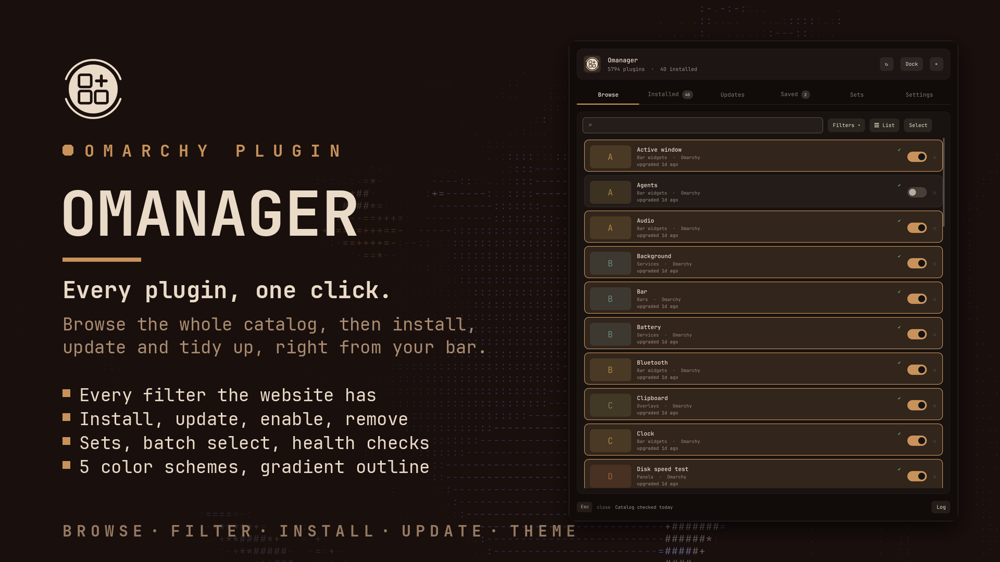

Click the bar button and the manager opens; click it again and it closes. It holds the full community catalog, with the same filters as the website, the plugins you have installed and the updates waiting for them, and it can pop out into a window of its own.

## Getting it

```bash
omarchy plugin add https://github.com/qempexe/omarchy-omanager.git --enable
omarchy restart shell
```

Then place it from the bar settings, or move it with `omarchy bar move io.github.qempexe.omanager --section right` (or `left`, `center`). A right click on the button opens straight to Settings.

It needs `curl` and `jq`, which Omarchy already has. Copying an install command and pasting into a text field go through `wl-clipboard` (`wl-copy`, `wl-paste`).

## Browsing

Five tabs: **Browse**, **Installed**, **Updates** (with *Update all*), **Saved** and **Sets**, plus **Settings**.

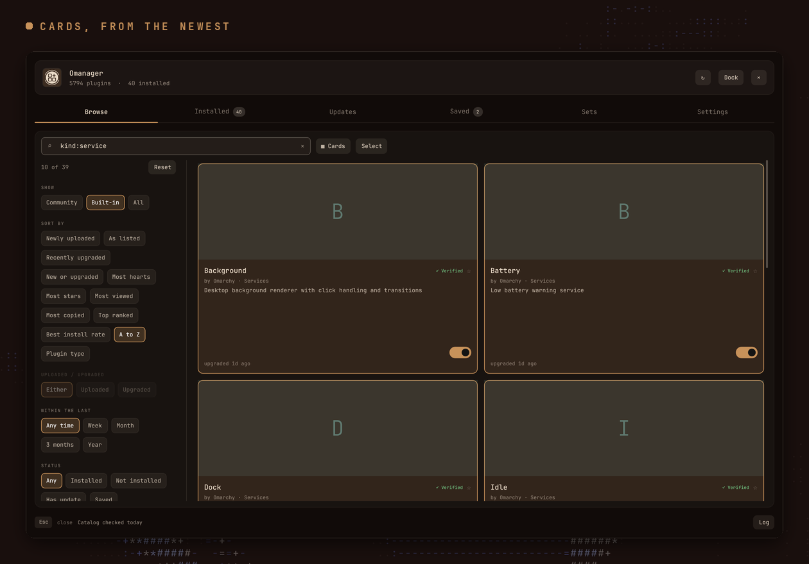

Four layouts: *List*, *List + stage* (a big preview of the selected plugin beside the list, from about 720 px wide), *Cards* in one to four columns, and *Compact*, a dense table of the whole catalog. The header's layout button cycles through them.

Every card shows the plugin's stars, hearts, views and install-command copies. Previews are downloaded once into a local cache and shown from there.

## Filters

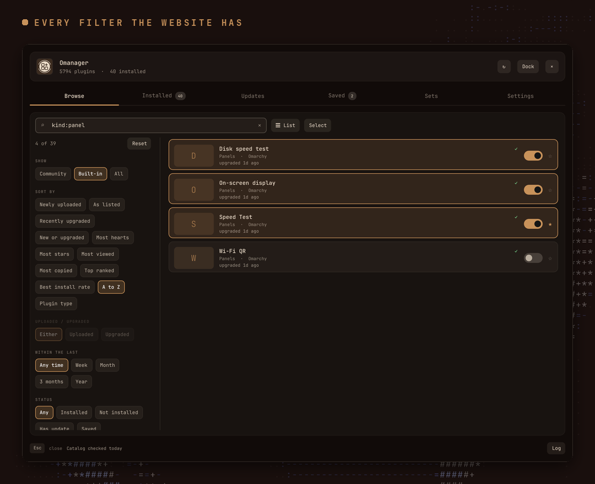

The same filters as [plugins.omarchy.org](https://plugins.omarchy.org), and a few more:

- **Show**: community, built-in, or all.
- **Sort by**: newly uploaded, as listed, recently upgraded, new or upgraded, most hearts, most stars, most viewed, most copied, top ranked, best install rate, A to Z, plugin type. The Installed tab can also sort by **newly installed**.
- **Verification**: any, verified or unverified.
- **Collections**: Kids, VPN, Bar, AI, Games and Security, worked out the way the website does it.
- **Category** and **tags**, several tags at once, with counts.
- **Status**: installed, not installed, has an update, saved, or new since your last visit.
- **Time**: uploaded, upgraded or either, within the last week, month, 3 months or year.
- **Search** names, ids, authors, categories, tags and descriptions, and narrow it like on the website with `tag:media`, `kind:panel` or `@author`.

## Installed plugins

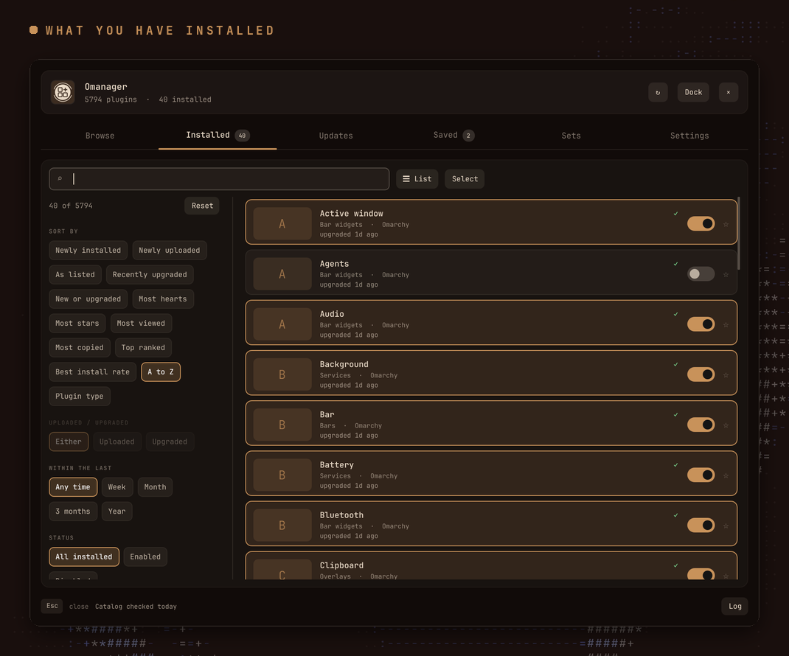

Installed plugins get an on/off switch, and an *Update* button when the catalog has a newer version. **Health** flags the ones that need a look: in a folder named differently from their id, not a git checkout, missing from the catalog, or without a manifest. Updates and removals always use the plugin's real folder.

The details show an installed plugin's recent commits, and with an update waiting, **Incoming** lists exactly what it would bring in.

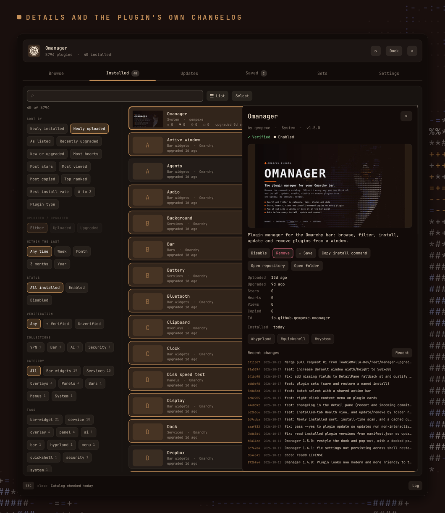

Right click any plugin for what applies to it. **Select** turns the list into checkboxes, with one bar to update, enable, disable, save or remove everything picked. **Sets** keeps a named snapshot of what you have installed, and restores it later or on another machine; restoring only enables and installs, it never removes anything.

## Colors

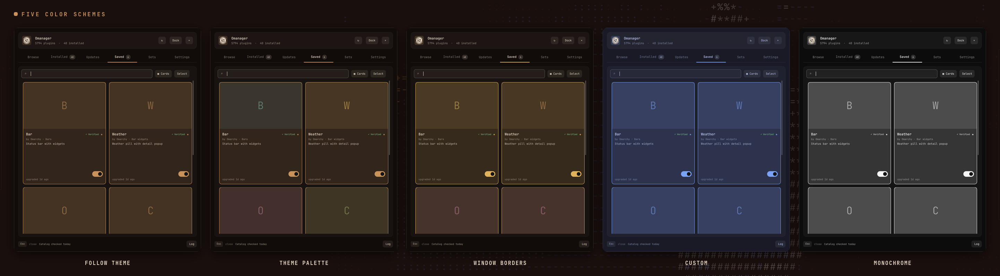

Five schemes: **Follow theme** matches your Omarchy theme live, **Theme palette** gives every category its own color from the theme, **Window borders** takes the colors of your active window border, **Custom** uses your own background, text and accent, and **Monochrome** removes every hue. Text can stay always readable, follow the theme, or use your own color.

The window can have an outline in your window border's gradient, at the border's own angle, or in one of its colors, a tint of the accent, and any opacity.

## The settings

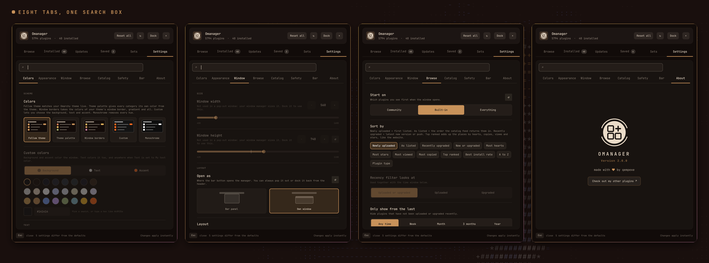

Eight tabs: **Colors**, **Appearance**, **Window**, **Browse**, **Catalog**, **Safety**, **Bar** and **About**. The search box at the top searches every setting at once, and every changed row has its own arrow back to the default. Everything applies at once and is saved to `~/.local/state/omarchy-omanager/settings.json`.

<table>
<tr>
<td>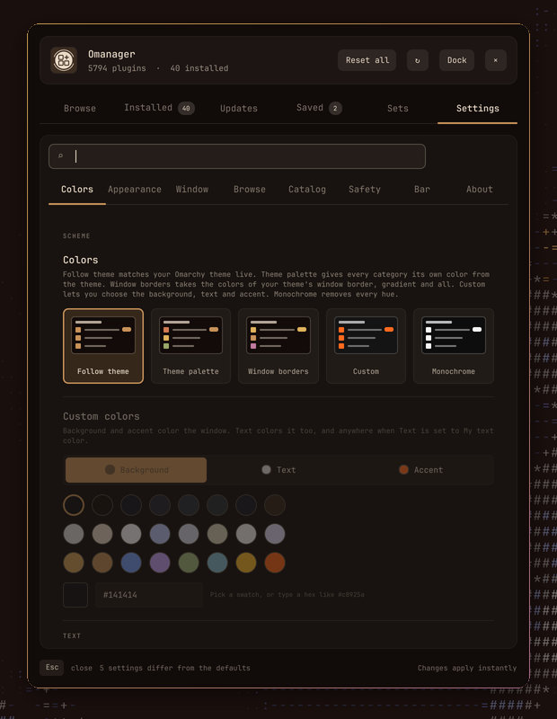</td>
<td>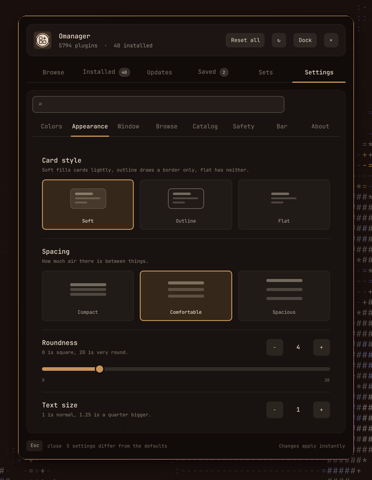</td>
<td>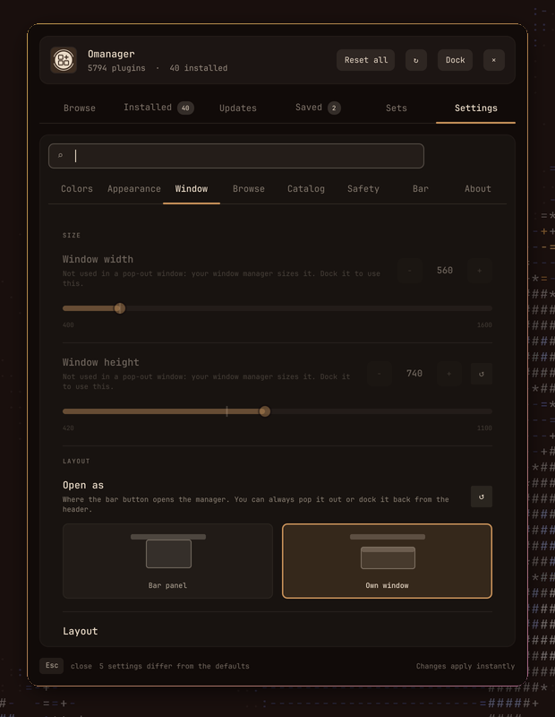</td>
<td>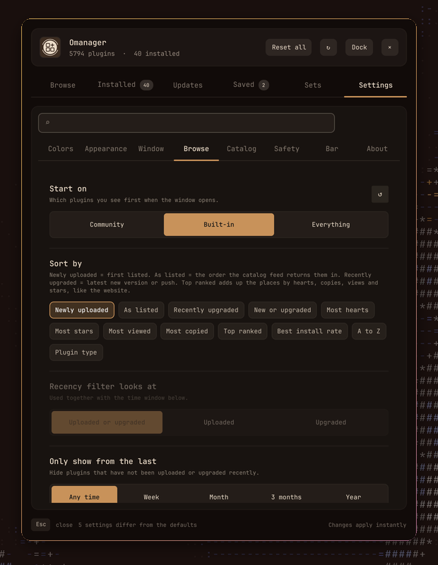</td>
</tr>
<tr>
<td>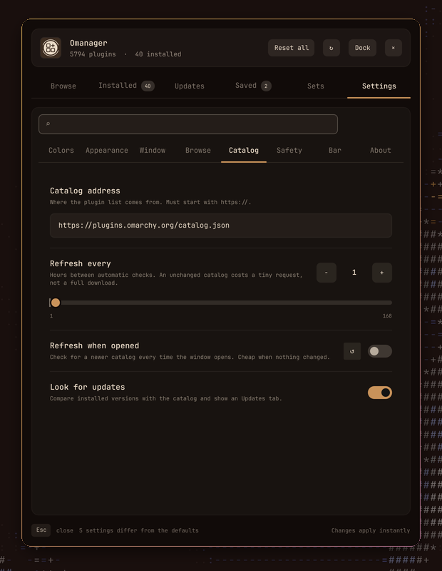</td>
<td>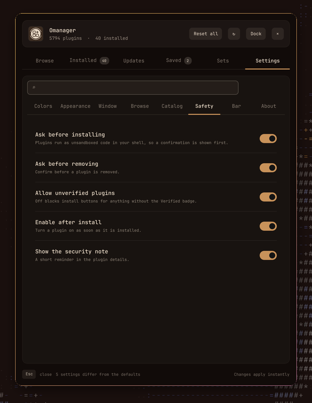</td>
<td>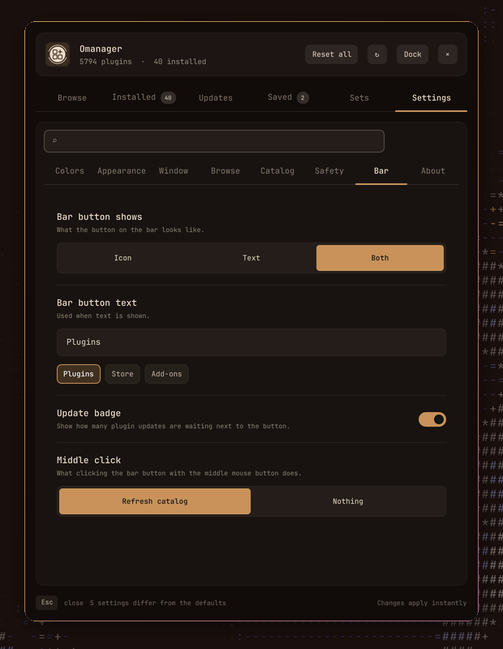</td>
<td>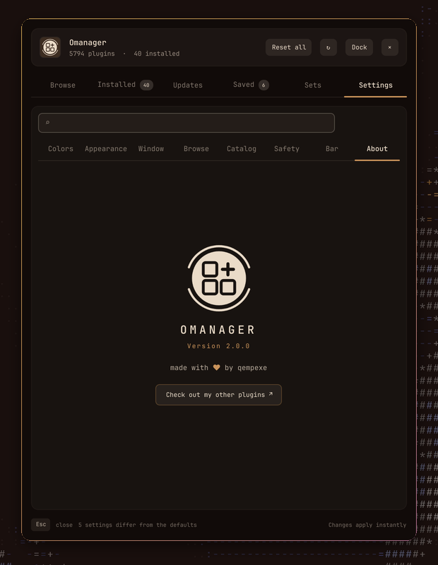</td>
</tr>
</table>

## Pop out and dock

The header's **Pop out** turns the manager into a real window you can move, resize and tile, and **Dock** puts it back on the bar. Filters, selection and search survive the switch. **Settings › Window › Open as** picks which one the bar button opens.

Hyprland tiles new windows. To float and center the popped-out manager, add to `~/.config/hypr/hyprland.lua`:

```lua
o.window({ class = "^org\\.quickshell$", title = "^Omanager$" }, { tag = "+omanager-window" })
o.window({ tag = "omanager-window" }, { float = true })
o.window({ tag = "omanager-window" }, { center = true })
o.window({ tag = "omanager-window" }, { size = { 560, 680 } })
```

## From the command line

```bash
omarchy-shell shell summon io.github.qempexe.omanager   # open the manager
omarchy-shell shell hide io.github.qempexe.omanager     # close it
omarchy-shell io.github.qempexe.omanager refresh        # download the catalog again
omarchy-shell io.github.qempexe.omanager status         # catalog, updates and activity, as JSON
```

## Good to know

- Plugins run as unsandboxed code in your shell. Omanager asks before it installs, updates or removes anything, and can refuse unverified plugins (**Settings › Safety**).
- Installs, updates and removals run through `omarchy plugin`, one at a time.
- What it talks to: `plugins.omarchy.org` for the catalog and the previews, `api.omarchyplugins.com` for hearts, views and copies, and a plugin's own repository when you look at incoming changes.
- The catalog is fetched compressed and only when it changed, so an unchanged catalog costs a tiny request. Without a connection Omanager works from the saved copy.
- Text fields read at most 1 KB from the clipboard, only on Ctrl+V or Shift+Insert.

## Inside

```
qml/
├── Service.qml          catalog, installed plugins, the action queue, preview cache, theme colors
├── BarWidget.qml        the bar button; owns the window state and opens the panel or the window
├── browse/              PluginCard, ResultsView, DetailPane, FilterSidebar, ContextMenu, SetsView
├── panel/               Panel, PopoutWindow, ManagerView, SettingsView, SettingRow, TileArt, AboutPage
├── core/                UiState (filters, results, colors), SettingsStore, Run (helper commands)
├── controls/            Txt, Btn, Chip, Sw, Section, PasteInput
└── js/
    ├── Model.js         catalog parsing, filters, sorts, search, commands (unit-tested)
    ├── Schema.js        every setting (generated by tools/gen.py)
    └── Theme.js         the theme's palette and window border
assets/                  the logo, light and dark
tools/gen.py             the settings list: writes manifest.json, Schema.js and BarWidget's settings
tests/                   node tests/test_model.js · node tests/test_theme.js · python3 tests/test_manifest.py
                         python3 tests/test_no_native_text.py · python3 tests/test_helpers.py
```

To add or change a setting, edit `tools/gen.py` and run `python3 tools/gen.py`.

## Updating and removing

```bash
omarchy plugin update io.github.qempexe.omanager
omarchy restart shell
```

```bash
omarchy plugin remove io.github.qempexe.omanager
rm -rf ~/.local/state/omarchy-omanager     # settings, saved plugins, sets, the cached catalog
rm -rf ~/.cache/omarchy-omanager           # cached previews
```

## Changelog

See [CHANGELOG.md](CHANGELOG.md).

## Credits and thanks

- Thanks to [@TowhidMolla-Dev](https://github.com/TowhidMolla-Dev) for plugin sets, batch select, the right-click menu, the changelog in the details and Health.
- Thanks to the **Omarchy** project and the plugin marketplace maintainers for the shell, the catalog and the stats it runs on.
- Thanks to **Quickshell** and **Qt** for the toolkit.
- Thanks to everyone who tests it and reports issues.

## Disclaimer

Omanager is an independent project, not affiliated with or endorsed by Omarchy or the plugin marketplace. Installing a plugin runs its author's code; approval on the marketplace is a listing, not a security review.

## License

[MIT](LICENSE)
